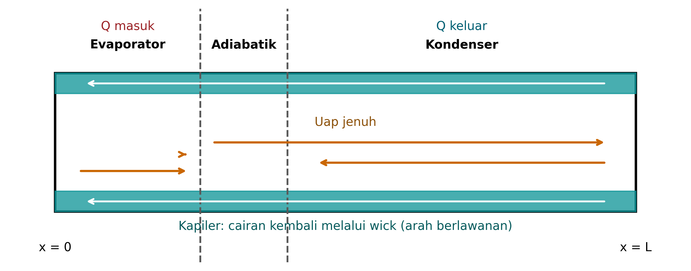

# DASAR TEORI

## Deskripsi Model dan Volume Kontrol

Pipa kalor dipandang sebagai volume kontrol satu dimensi dengan koordinat $x$ dari ujung tertutup evaporator menuju ujung kondenser. Panjang total $L$ merupakan jumlah panjang evaporator $L_e$, bagian adiabatik $L_a$, dan kondenser $L_c$. Ruang uap memiliki luas $A_v$, sedangkan luas annulus sumbu cair adalah $A_w$. Gambar @fig-skema memperlihatkan arah aliran yang berlawanan: uap bergerak dari evaporator ke kondenser dan cairan kembali melalui sumbu.

{#fig-skema width=95%}

Asumsi kesetimbangan jenuh memungkinkan sifat cairan dan uap dievaluasi pada temperatur operasi $T_v$. Model tidak menyelesaikan distribusi temperatur dinding atau antarmuka, sehingga $T_v$ adalah temperatur efektif untuk perhitungan hidraulik. Resistansi kondenser menghubungkan temperatur tersebut dengan temperatur sink.

## Neraca Energi dan Massa

Dengan kehilangan kalor pada bagian adiabatik diabaikan, daya yang masuk evaporator sama dengan daya yang dilepas kondenser. Temperatur operasi didekati dengan

$$
T_v=T_{sink}+R_cQ,
$$ {#eq-temperature}

dengan $Q$ adalah daya masukan, $R_c$ resistansi termal efektif kondenser, dan $T_{sink}$ temperatur sink. Pendekatan ini adalah kondisi batas sederhana, bukan model radiator. Nilai $R_c$ harus diganti apabila radiasi atau pertukaran kalor diselesaikan secara lebih rinci.

Laju aliran massa lokal berkaitan dengan kalor aksial $Q_x(x)$ melalui kalor laten:

$$
\dot m(x)=\frac{Q_x(x)}{h_{fg}}.
$$ {#eq-mass}

Untuk pemanasan dan pendinginan merata, profil kalor aksial adalah

$$
Q_x(x)=
\begin{cases}
Q x/L_e, & 0\leq x\leq L_e,\\
Q, & L_e<x\leq L_e+L_a,\\
Q\left[1-(x-L_e-L_a)/L_c\right], & L_e+L_a<x\leq L.
\end{cases}
$$ {#eq-axialheat}

Profil tersebut bernilai nol pada kedua ujung dan maksimum sebesar $Q$ di antara evaporator dan kondenser. Integral pembangkitan uap di evaporator sama dengan integral kondensasi di kondenser sehingga neraca massa global terpenuhi secara konstruksi.

## Sifat Natrium

Tekanan jenuh natrium dihitung dengan korelasi Browning–Potter yang direkomendasikan Fink dan Leibowitz [7]:

$$
\ln P=11{,}9463-\frac{12633{,}73}{T_v}-0{,}4672\ln T_v,
$$ {#eq-pressure}

dengan $P$ dalam MPa dan $T_v$ dalam K. Program mengonversi tekanan ke Pa. Entalpi penguapan dihitung dengan

$$
h_{fg}=393{,}37(1-T_v/T_{cr})+4398{,}6(1-T_v/T_{cr})^{0{,}29302},
$$ {#eq-latent}

dengan $h_{fg}$ dalam kJ/kg dan $T_{cr}=2503{,}7$ K. Densitas cairan dalam kg/m³ adalah

$$
\rho_l=219+275{,}32\tau+511{,}58\tau^{1/2},
\qquad \tau=1-T_v/T_{cr}.
$$ {#eq-density}

Viskositas cairan dalam Pa·s dihitung dari

$$
\ln\mu_l=-6{,}4406-0{,}3958\ln T_v+\frac{556{,}835}{T_v}.
$$ {#eq-viscosity}

Tegangan permukaan mengikuti bentuk Van der Waals:

$$
\sigma=0{,}2405(1-T_v/T_{cr})^{1{,}126}.
$$ {#eq-sigma}

Densitas uap didekati dengan gas ideal,

$$
\rho_v=\frac{PM}{R_uT_v},
$$ {#eq-idealgas}

dengan massa molar natrium $M=0{,}02298977$ kg/mol. Viskositas uap menggunakan estimasi gas encer bola keras karena laporan sifat yang sama tidak memberikan korelasi viskositas uap. Pendekatan ini merupakan sumber ketidakpastian dan perlu diganti untuk analisis berketelitian tinggi.

## Aliran Uap

Kecepatan rata-rata uap pada setiap posisi adalah

$$
u_v(x)=\frac{\dot m(x)}{\rho_v A_v}.
$$ {#eq-velocity}

Bilangan Reynolds dan Mach dinyatakan sebagai

$$
Re_v=\frac{\rho_v u_vD_v}{\mu_v},\qquad Ma_v=\frac{u_v}{a_v},
$$ {#eq-dimensionless}

dengan $a_v=\sqrt{\gamma R_vT_v}$ dan $\gamma=5/3$ untuk pendekatan gas monoatomik. Faktor gesek Darcy ditentukan dengan $64/Re_v$ untuk $Re_v<2300$ dan korelasi Blasius $0{,}3164Re_v^{-0{,}25}$ untuk kondisi di luar rentang tersebut. Gradien rugi tekanan uap adalah

$$
\frac{d(\Delta P_v)}{dx}=\frac{f}{D_v}\frac{\rho_v u_v^2}{2}.
$$ {#eq-vaporpressure}

Persamaan @eq-vaporpressure diintegrasikan sepanjang pipa. Bilangan Mach digunakan sebagai pemeriksaan penerimaan pendekatan tak kompresibel; kasus acuan mensyaratkan $Ma<0{,}3$. Apabila batas tersebut terlampaui, hasil harus diinterpretasikan sebagai penyaringan dan model kompresibel diperlukan.

## Aliran Balik Cairan dan Tekanan Kapiler

Aliran cairan di dalam medium berpori mengikuti hukum Darcy. Untuk arah berlawanan dengan uap, besar gradien rugi tekanannya adalah

$$
\frac{d(\Delta P_l)}{dx}=\frac{\mu_l\dot m(x)}{\rho_l K A_w}.
$$ {#eq-darcy}

Untuk profil kalor pada Persamaan @eq-axialheat, integrasi menghasilkan panjang efektif

$$
L_{eff}=\frac{L_e}{2}+L_a+\frac{L_c}{2}.
$$ {#eq-effectivelength}

Dengan demikian, rugi tekanan cairan total dapat pula ditulis dalam bentuk kompak

$$
\Delta P_l=\frac{\mu_l Q L_{eff}}{\rho_l K A_w h_{fg}}.
$$ {#eq-liquidpressure}

Tekanan kapiler maksimum didekati dengan persamaan Young–Laplace:

$$
\Delta P_{cap}=\frac{2\sigma\cos\theta_c}{r_c}.
$$ {#eq-capillary}

Kondisi operasi berkelanjutan adalah

$$
\Delta P_{cap}\geq \Delta P_v+\Delta P_l+\Delta P_g,
$$ {#eq-balance}

dengan tekanan akibat percepatan efektif

$$
\Delta P_g=\rho_l g_{eff}L\sin\theta.
$$ {#eq-gravity}

Sudut $\theta$ adalah kemiringan terhadap arah yang menghasilkan komponen hidrostatik aksial. Pada kasus mikrogravitasi ideal, $g_{eff}=0$ sehingga $\Delta P_g=0$. Model juga menerima percepatan nonnol untuk meniru residu akselerasi atau membandingkan kondisi Bumi. Nilai nol pada mikrogravitasi ideal tidak berarti seluruh masalah dua fase menghilang; kapilaritas, gesekan, dan inersia uap tetap diperhitungkan.

## Batas Transportasi Kalor

Batas kapiler $Q_{cap}$ adalah daya yang membuat ruas kanan Persamaan @eq-balance sama dengan $\Delta P_{cap}$. Karena rugi tekanan uap tidak selalu linear terhadap $Q$, program mencari akar margin kapiler dengan biseksi. Apabila tekanan hidrostatik saja sudah melebihi tekanan kapiler, batas kapiler ditetapkan nol sebagai indikator ketidakmampuan model beroperasi pada kondisi tersebut.

Batas sonik disaring menggunakan bentuk yang lazim dalam literatur pipa kalor [3, 4]:

$$
Q_s=0{,}474 A_v h_{fg}\sqrt{\rho_vP}.
$$ {#eq-sonic}

Batas entrainment didekati dengan

$$
Q_{ent}=A_v h_{fg}\sqrt{\frac{\rho_v\sigma}{2r_c}}.
$$ {#eq-entrainment}

Batas pendidihan di dalam sumbu dihitung sebagai

$$
Q_b=\frac{2\pi L_e k_{eff}T_v}{h_{fg}\rho_v\ln(r_i/r_v)}
\left(\frac{2\sigma}{r_b}-\Delta P_v-\Delta P_l-\Delta P_g\right),
$$ {#eq-boiling}

dengan $k_{eff}$ konduktivitas efektif sumbu, $r_b$ jari-jari nukleasi, $r_v$ jari-jari ruang uap, dan $r_i=r_v+t_w$. Ketiga persamaan terakhir bersifat penyaringan dengan ketidakpastian korelasi. Nilai terkecil dari keempat batas digunakan sebagai batas pengatur untuk perbandingan, tetapi bukan jaminan bahwa seluruh mekanisme kegagalan telah tercakup.

## Metode Numerik

Domain dibagi menjadi $N$ sel dengan titik $x_i=iL/N$. Besaran lokal dihitung pada setiap titik. Integrasi rugi tekanan menggunakan aturan trapesium:

$$
\int_0^L y(x)\,dx\approx\sum_{i=0}^{N-1}\frac{y_i+y_{i+1}}{2}(x_{i+1}-x_i).
$$ {#eq-trapezoid}

Untuk mencari $Q_{cap}$, algoritme pertama memeriksa margin pada $Q=0$. Jika margin tidak positif, kapasitas kapiler adalah nol. Jika positif, batas atas daya digandakan sampai margin berubah tanda. Biseksi kemudian mempersempit interval. Skema ini dipilih karena margin menurun secara monoton pada rentang yang dianalisis dan tidak membutuhkan turunan.

## Hipotesis

Berdasarkan persamaan di atas, dirumuskan dua dugaan yang diuji secara numerik. Pertama, pada geometri acuan, rugi tekanan cairan lebih besar daripada rugi tekanan uap sehingga batas kapiler menjadi pengatur pada temperatur sekitar 1000 K. Kedua, peningkatan percepatan efektif pada orientasi merugikan menurunkan kapasitas kapiler, sedangkan mikrogravitasi ideal menghilangkan kontribusi hidrostatik. Dugaan ini hanya berlaku untuk parameter yang diuji dan tidak digeneralisasi ke seluruh desain pipa kalor.
