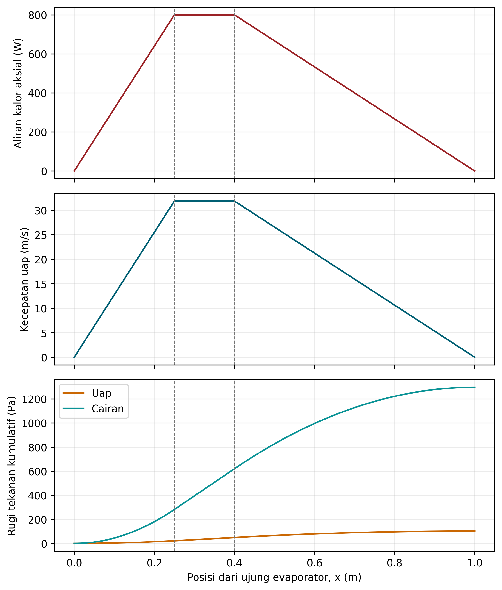
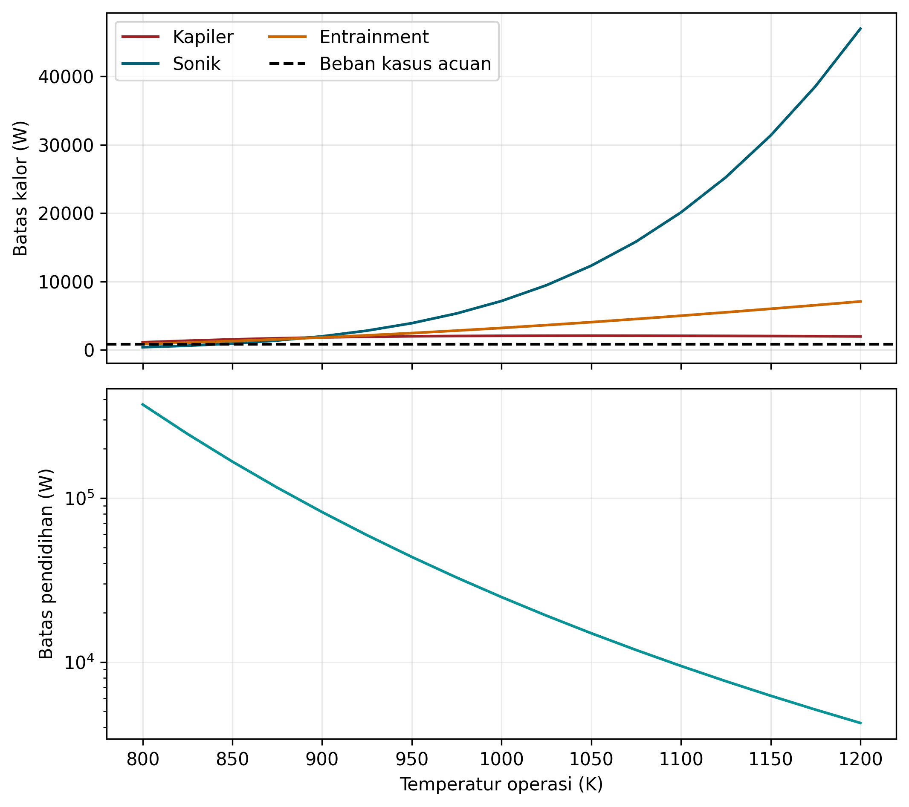
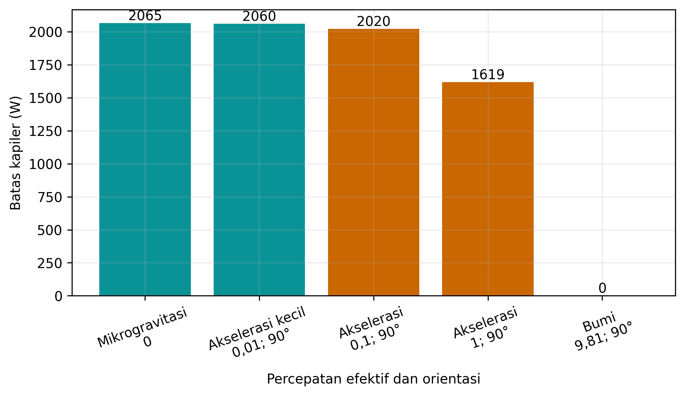

# HASIL DAN PEMBAHASAN

## Hasil Kasus Acuan

Kasus acuan menghasilkan temperatur operasi 1000 K dari hubungan $T_v=700+0{,}375(800)$. Sifat fluida yang digunakan pada temperatur tersebut disajikan pada Tabel @tbl-sifat. Tekanan jenuh sebesar 19,95 kPa dan kalor laten sekitar 4,02 MJ/kg menghasilkan laju aliran massa maksimum $1{,}98784\times10^{-4}$ kg/s.

| Besaran | Nilai | Satuan |
|:--------|------:|:------:|
| Tekanan jenuh | 19.945,87 | Pa |
| Kalor laten | 4.024.461,18 | J/kg |
| Densitas cairan | 780,818 | kg/m³ |
| Densitas uap | 0,055151 | kg/m³ |
| Viskositas cairan | $1{,}80848\times10^{-4}$ | Pa·s |
| Viskositas uap | $2{,}52981\times10^{-5}$ | Pa·s |
| Tegangan permukaan | 0,135455 | N/m |
| Konduktivitas cairan | 54,244 | W/(m·K) |
| Kecepatan suara pendekatan | 776,380 | m/s |

: Sifat natrium pada temperatur operasi 1000 K. {#tbl-sifat}

Hasil hidraulik utama diberikan pada Tabel @tbl-acuan. Rugi tekanan cairan sebesar 1296,43 Pa jauh lebih besar daripada rugi tekanan uap sebesar 103,02 Pa. Perbandingan ini konsisten dengan dominasi hambatan viskos pada kanal berpori. Tekanan kapiler yang tersedia adalah 3612,13 Pa sehingga tersisa margin 2212,68 Pa. Tidak ada tekanan hidrostatik karena percepatan efektif ditetapkan nol.

| Besaran | Nilai |
|:--------|------:|
| Laju massa maksimum | $1{,}98784\times10^{-4}$ kg/s |
| Kecepatan uap maksimum | 31,8696 m/s |
| Bilangan Reynolds maksimum | 833,724 |
| Bilangan Mach maksimum | 0,04105 |
| Tekanan kapiler | 3612,13 Pa |
| Rugi tekanan uap | 103,02 Pa |
| Rugi tekanan cairan | 1296,43 Pa |
| Rugi tekanan gravitasi | 0 Pa |
| Margin kapiler | 2212,68 Pa |
| Utilisasi batas pengatur | 38,74% |

: Ringkasan hasil kasus acuan 800 W pada mikrogravitasi. {#tbl-acuan}

Bilangan Reynolds maksimum berada dalam rentang laminar pada model dan bilangan Mach jauh di bawah 0,3. Oleh karena itu, penggunaan pendekatan rugi tekanan tak kompresibel dapat diterima untuk kasus ini sebagai penyaringan. Pernyataan tersebut tidak berlaku otomatis pada temperatur rendah ketika densitas uap jauh lebih kecil.

## Profil Aksial

Gambar @fig-profil menunjukkan kalor aksial meningkat linear di evaporator, konstan pada bagian adiabatik, lalu menurun linear di kondenser. Kecepatan uap mengikuti bentuk yang sama karena sifat fluida dan luas penampang konstan pada satu perhitungan. Nilai maksimum terjadi di sepanjang bagian adiabatik, yaitu antara $x=0,25$ m dan $x=0,40$ m.

{#fig-profil width=88%}

Rugi tekanan kumulatif bertambah paling cepat di bagian adiabatik karena laju massa berada pada nilai maksimum. Di evaporator dan kondenser, gradien berubah mengikuti profil laju massa. Rugi tekanan cairan memiliki bentuk serupa dengan skala yang lebih besar. Hasil ini menegaskan bahwa panjang efektif dalam Persamaan @eq-effectivelength bukan sekadar panjang total; distribusi pemanasan dan pendinginan ikut menentukan integrasi aliran.

## Batas Operasi dan Pengaruh Temperatur

Pada kasus acuan, batas kapiler adalah 2064,88 W, batas sonik 7155,53 W, batas entrainment 3212,10 W, dan batas pendidihan 24.232,80 W. Batas kapiler merupakan nilai terkecil sehingga menjadi pengatur. Daya 800 W menggunakan 38,74% dari batas tersebut. Batas pendidihan bergantung pada rugi tekanan kasus aktual, sedangkan peta temperatur menggunakan proba daya kecil agar perbandingan sifat lebih konsisten; karena itu terdapat perbedaan kecil antara nilai pendidihan pada peta dan kasus acuan.

Tabel @tbl-batas dan Gambar @fig-batas memperlihatkan perubahan mekanisme pengatur. Pada 800 K batas sonik hanya 393,48 W, lebih rendah daripada batas kapiler dan entrainment. Pada 900 K, batas entrainment sedikit lebih rendah daripada batas kapiler. Pada 1000–1200 K, batas kapiler menjadi pengatur. Peningkatan temperatur menaikkan tekanan dan densitas uap sehingga batas sonik meningkat tajam. Sebaliknya, tegangan permukaan menurun terhadap temperatur dan pada akhirnya mengurangi tekanan kapiler.

```{=latex}
\begin{scriptsize}
\setlength{\tabcolsep}{2pt}
```
| Temperatur (K) | Kapiler (W) | Sonik (W) | Entrainment (W) | Pendidihan (W) | Pengatur |
|---------------:|------------:|----------:|----------------:|---------------:|:---------|
| 800 | 1119,89 | 393,48 | 872,58 | 372.531,62 | Sonik |
| 900 | 1828,89 | 1989,01 | 1822,46 | 82.149,60 | Entrainment |
| 1000 | 2064,88 | 7155,53 | 3212,10 | 24.874,49 | Kapiler |
| 1100 | 2066,85 | 20.110,97 | 5000,63 | 9449,29 | Kapiler |
| 1200 | 1969,78 | 46.978,71 | 7086,28 | 4241,04 | Kapiler |

: Peta batas transportasi kalor pada temperatur tetap. {#tbl-batas}
```{=latex}
\end{scriptsize}
```

{#fig-batas width=92%}

Batas kapiler meningkat dari 800 K hingga sekitar 1050–1100 K kemudian menurun. Perilaku nonmonoton tersebut muncul dari kompetisi beberapa sifat: kenaikan kalor laten atau densitas uap memengaruhi rugi tekanan dan laju massa, sedangkan viskositas cairan serta tegangan permukaan menurun. Model tidak mendukung kesimpulan bahwa temperatur yang lebih tinggi selalu meningkatkan kapasitas. Selain itu, hasil di bawah rentang rekomendasi sifat atau di dekat kondisi sonik harus diperlakukan dengan kehati-hatian.

## Pengaruh Beban Kalor

Studi beban menggunakan resistansi kondenser tetap sehingga setiap kenaikan daya juga menaikkan temperatur operasi. Hasil pada Tabel @tbl-beban memperlihatkan dua pengaruh yang berlawanan. Kenaikan daya meningkatkan laju massa yang diperlukan, tetapi kenaikan temperatur meningkatkan densitas uap dan dapat menurunkan kecepatan serta Mach. Akibatnya, Mach maksimum justru menurun dari 0,223 pada 300 W menjadi 0,00617 pada 1600 W. Perilaku ini merupakan konsekuensi kondisi batas $T_v=T_{sink}+R_cQ$, bukan karakter universal pipa kalor.

```{=latex}
\begin{small}
```
| Daya (W) | Temperatur (K) | Pengatur | Utilisasi (%) | Mach maksimum | Margin kapiler (Pa) |
|---------:|---------------:|:---------|--------------:|--------------:|--------------------:|
| 300 | 812,5 | Sonik | 60,85 | 0,22343 | 3121,80 |
| 600 | 925,0 | Kapiler | 31,20 | 0,07824 | 2625,15 |
| 800 | 1000,0 | Kapiler | 38,74 | 0,04105 | 2212,68 |
| 1200 | 1150,0 | Kapiler | 59,21 | 0,01405 | 1308,82 |
| 1600 | 1300,0 | Kapiler | 87,75 | 0,00617 | 344,51 |

: Studi beban dengan temperatur sink dan resistansi kondenser tetap. {#tbl-beban}
```{=latex}
\end{small}
```

Margin kapiler menurun ketika beban menjadi besar dan utilisasi mencapai 87,75% pada 1600 W. Oleh sebab itu, peningkatan beban tetap mendekatkan sistem pada keterbatasan meskipun Mach menurun. Hasil ini memperlihatkan bahwa pemeriksaan satu indikator tidak cukup untuk menilai kelayakan operasi.

## Pengaruh Percepatan Efektif

Gambar @fig-gravitasi dan Tabel @tbl-gravitasi menunjukkan batas kapiler pada 1000 K untuk beberapa percepatan. Percepatan 0,01 m/s² pada orientasi 90° hanya menurunkan kapasitas dari 2064,88 W menjadi 2060,42 W. Penurunan menjadi lebih besar pada 1 m/s², yaitu 1618,53 W. Pada percepatan 9,81 m/s² dengan orientasi merugikan, tekanan hidrostatik melebihi tekanan kapiler sehingga tidak ada kapasitas positif menurut model.

| Percepatan (m/s²) | Orientasi | Batas kapiler (W) |
|------------------:|:---------:|------------------:|
| 0 | 0° | 2064,88 |
| 0,01 | 90° | 2060,42 |
| 0,1 | 90° | 2020,25 |
| 1 | 90° | 1618,53 |
| 9,81 | 90° | 0 |

: Pengaruh percepatan efektif pada batas kapiler pada 1000 K. {#tbl-gravitasi}

{#fig-gravitasi width=92%}

Hasil kasus Bumi tidak berarti pipa kalor natrium secara umum tidak dapat bekerja pada orientasi vertikal. Kesimpulan hanya berlaku untuk geometri, sumbu, dan orientasi acuan. Pipa dengan pori lebih kecil, permeabilitas lebih tinggi, panjang lebih pendek, atau orientasi menguntungkan dapat memiliki perilaku berbeda. Di sisi lain, hasil mikrogravitasi memperlihatkan alasan kapilaritas penting: sirkulasi tetap dimungkinkan tanpa kontribusi gravitasi selama neraca Persamaan @eq-balance terpenuhi.

## Pengaruh Jari-Jari Pori

Tabel @tbl-pori menunjukkan bahwa pembesaran pori dari 25 µm menjadi 150 µm menurunkan batas kapiler dari 5544,26 W menjadi 1032,44 W ketika permeabilitas dibuat tetap. Batas entrainment juga menurun, tetapi dengan laju berbeda. Pada pori 25 µm, batas entrainment sedikit lebih tinggi daripada batas kapiler sehingga kapiler masih sedikit lebih kecil; perbedaan keduanya sangat dekat dan tidak boleh ditafsirkan melebihi ketidakpastian korelasi.

| Jari-jari pori (µm) | Batas kapiler (W) | Batas entrainment (W) |
|--------------------:|------------------:|----------------------:|
| 25 | 5544,26 | 5563,52 |
| 50 | 2974,82 | 3934,00 |
| 75 | 2064,88 | 3212,10 |
| 100 | 1548,66 | 2781,76 |
| 150 | 1032,44 | 2271,30 |

: Pengaruh jari-jari pori dengan permeabilitas dipertahankan tetap. {#tbl-pori}

Hasil ini tidak dapat digunakan untuk menyimpulkan bahwa pori sekecil mungkin selalu optimal. Pada material nyata, pengecilan pori dapat menurunkan permeabilitas dan meningkatkan rugi tekanan cairan. Model sengaja mempertahankan $K$ untuk isolasi parameter; studi desain selanjutnya harus menggunakan korelasi eksperimen yang menghubungkan $K$, $r_c$, porositas, dan struktur sumbu.

## Konvergensi Grid dan Verifikasi

Seluruh sepuluh pengujian otomatis berhasil. Pengujian tekanan jenuh pada 1156 K berada dalam 3% dari 1 atm, sifat pada 1000 K sesuai toleransi terhadap nilai acuan, dan margin kapiler pada daya batas mendekati nol. Program juga menolak permeabilitas nonpositif. Hasil konvergensi diberikan pada Tabel @tbl-grid.

| Jumlah sel | Rugi tekanan total (Pa) | Selisih relatif terhadap 1600 sel (%) |
|-----------:|------------------------:|---------------------------------------:|
| 50 | 1398,9667 | 0,03478 |
| 100 | 1399,4535 | $<10^{-10}$ |
| 200 | 1399,4535 | $<10^{-10}$ |
| 400 | 1399,4535 | $<10^{-10}$ |
| 800 | 1399,4535 | $<10^{-10}$ |
| 1600 | 1399,4535 | 0 |

: Konvergensi jumlah rugi tekanan uap dan cairan pada kasus acuan. {#tbl-grid}

Perbedaan terbesar hanya 0,03478% pada 50 sel dan hampir menghilang setelah 100 sel. Hasil ini masuk akal karena integrand berasal dari profil linear per bagian dan grid 100 sel atau lebih menempatkan batas geometri tepat pada titik integrasi. Konvergensi tersebut menunjukkan konsistensi diskretisasi, bukan bukti bahwa model telah sesuai dengan fisika eksperimen.

## Pembahasan Keterbatasan Model

Model memberikan hasil yang konsisten dengan dua hipotesis: rugi tekanan cairan dominan pada kasus acuan dan percepatan merugikan menurunkan kapasitas kapiler. Namun, beberapa keterbatasan menentukan interpretasi hasil. Pertama, temperatur uap seragam menghilangkan gradien temperatur aksial dan resistansi evaporator. Kedua, gas ideal dan viskositas uap bola keras merupakan penyederhanaan. Ketiga, persamaan faktor gesek tidak menyelesaikan aliran kompresibel, pusaran, atau interaksi gesek antarmuka.

Keempat, kondisi jenuh sumbu mengabaikan inventor cairan dan kemungkinan pengeringan lokal sebelum batas global. Kelima, model pendidihan sangat sensitif terhadap jari-jari nukleasi dan konduktivitas efektif yang tidak dikalibrasi. Keenam, start-up beku dan gas takterkondensasi tidak dicakup meskipun keduanya penting untuk pipa kalor alkali. Ketujuh, kasus tidak dikopelkan dengan teras reaktor, radiator, atau umpan balik reaktivitas.

Dengan demikian, istilah yang tepat untuk tahap ini adalah **verifikasi kode dan studi numerik**, bukan validasi desain. Validasi memerlukan data temperatur, daya, tekanan, geometri sumbu, dan kondisi orientasi dari eksperimen yang terdokumentasi. Ketidakpastian parameter juga perlu dianalisis sebelum hasil digunakan untuk menetapkan margin keselamatan.
